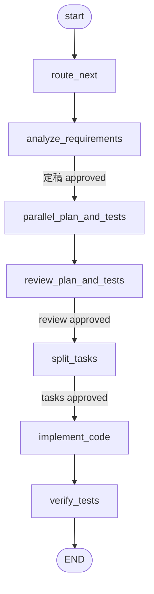

# ai4se-sdd-loop-workflow

从**原始需求 → 计划/用例 → 评审 → 任务 → 代码 → 测试**的工程化 Workflow。  
引擎仓库可 clone 到业务项目内（或同级）；**业务配置与文档产出在业务项目根**，不写进本仓库。

---

## 1. 快速使用

### 1.1 前置

- Python 3.10+
- 本机已登录可用的 AI CLI：`cursor` / `claude_code` / `omp`（调试可用 `echo`）
- E2E 需要 Node 18+（Playwright MCP）；可在业务配置里关闭 E2E

### 1.2 接入（一次）

在**业务项目根**（与 `src/`、`pom.xml` / `package.json` 同级）：

```bash
# 1) 拿到引擎（目录名建议保持 ai4se-sdd-loop-workflow）
git clone <本仓库地址> ai4se-sdd-loop-workflow
cd ai4se-sdd-loop-workflow
python3 -m venv .venv && source .venv/bin/activate   # Windows: .venv\Scripts\activate
pip install -e .

# 2) 回到业务根做 init（生成配置 + skill）
cd ..
sdd-loop-workflow:init
# 若命令找不到引擎，加：--workflow-root ./ai4se-sdd-loop-workflow
```

Windows 同理：`pip install -e .` 后在业务根执行 `sdd-loop-workflow:init`。

### 1.3 启动一条需求

在**业务项目根**执行（cwd = 业务根）：

```bash
# 交互（会问澄清 / 等人审批）
sdd-loop-workflow:start --tool cursor --file "/绝对路径/prd.md" --name login

# 无人值守（不提问，自动过门禁；用 *.auto.md prompt）
sdd-loop-workflow:start --tool cursor --file "/绝对路径/prd.md" --name login --auto

# 续跑：不要加 --fresh；已有产出时也可只传 --name
sdd-loop-workflow:start --tool cursor --name login
```

也可以进引擎目录用 `./start.sh` / `.\start.cmd`（参数相同）。  
在 Cursor / Claude / omp 里可用 **start-workflow** skill：它只**拼命令**，须在 **AI session 外**的终端执行。

常用开关：

| 开关 | 作用 |
|------|------|
| `--file` / `-f` | 需求文件 |
| `--name` / `-n` | 产出目录名 → `<业务根>/<docs_dir>/<name>/` |
| `--auto` | 无人值守（隐含跳过澄清） |
| `--fresh` | 清空该需求目录产出后重来（保留 `00-requirement.md`） |
| `--tool` | `cursor` / `claude_code` / `omp` / `echo` |
| `--skip-install` | 跳过 venv 依赖安装（加速） |

产出默认在 `<业务根>/spec/<name>/`（`docs_dir` 可在业务配置里改成 `docs` 等）。

---

## 2. `init` 产生的文件与作用

`sdd-loop-workflow:init` 在**业务项目根**写入两块内容（已存在的文件**不覆盖**）：

```text
your-project/                          # 业务项目根
├── .cursor/skills/start-workflow/     # Cursor：拼启动命令的 skill
├── .claude/skills/start-workflow/     # Claude Code：同上
├── .omp/skills/start-workflow/        # Oh My Pi：同上
├── sdd-loop-workflow-config/          # ★ 业务侧运行时配置（改这里）
│   ├── workflow.yaml                  # docs_dir、e2e 等
│   ├── ai-rules.yaml                  # 各节点注入哪些规则文件
│   └── ai-rules/                      # 规则正文（markdown）
│       └── ddd-design-standard.md     # 示例，按项目改写
└── ai4se-sdd-loop-workflow/           # 引擎（可选嵌套 clone）
```

| 路径 | 作用 |
|------|------|
| `sdd-loop-workflow-config/workflow.yaml` | **业务运行时**：`docs_dir`（默认 `spec`）、`e2e.enabled` / `headless` / `base_url`。节点 tool/prompt **不在这里**，在引擎 `config/workflow.yaml`。 |
| `sdd-loop-workflow-config/ai-rules.yaml` | **扩展规则映射**：`ai_rules_dir` + 每个节点要注入的 md 列表。优先级高于引擎通用 prompt。 |
| `sdd-loop-workflow-config/ai-rules/*.md` | **规则正文**；运行时拼进 `{{ai_rules}}`。 |
| `.cursor|claude|omp/skills/start-workflow/` | 教当前 Agent 如何根据上下文拼 `sdd-loop-workflow:start ...`，**不在对话里执行**。 |

引擎内模板真源：`ai4se-sdd-loop-workflow/config/sdd-loop-workflow-config/`。  
跑起来之后，每次需求还会在 `<docs_dir>/<name>/` 下生成 `01`～`05` 等文档（见 §3）。

---

## 3. Workflow 有哪些节点



| 节点 | 模式 | 产出（相对 `<docs_dir>/<name>/`） | 做什么 |
|------|------|-----------------------------------|--------|
| `analyze_requirements` | interactive | `draft/01-…` → `01-requirements.md` | 需求分析与澄清；`requirement_approval` |
| `create_plan` | headless | `02-plan.md` | 实现计划初稿（可带 pending） |
| `design_test_cases` | headless | `02-test-cases.md` | 测试用例初稿（可带 pending） |
| `parallel_plan_and_tests` | （编排） | 上两者 | 线程池并行跑 plan + test |
| `review_plan_and_tests` | interactive | `02-plan-test-review.md` + 修订 plan/test | 消解 pending、业务交叉比对、三份 approval |
| `split_tasks` | interactive | `03-tasks.md` | 任务拆分 + API 详细设计；`tasks_approval` |
| `implement_code` | interactive | 业务代码 + `04-implementation.md` | **只写生产代码**，不写测试 |
| `verify_tests` | interactive | `src/test` + `05-test-report.md` | 按用例写/跑单测、API、可选 E2E |

要点：

- **`--auto`**：每个节点改用 `prompts/*.auto.md`（顶部标明无人值守）；不向用户提问，按 **`ai-rules` → 系统规范** 消解 pending 并写 `approved`。工程规范（简单至上、勿过度设计等）与人工版相同。
- **人工模式**：用 `prompts/*.md`；澄清与审批需用户确认。
- **续跑**：再次 start（勿加 `--fresh`），router 根据已有 md + approval 决定从哪一节点继续。
- **测试边界**：用例设计在 plan/test → review；测试代码只在 `verify_tests`；`implement_code` 不写 `src/test`。

典型产出目录：

```text
<业务根>/spec/<name>/
├── 00-requirement.md
├── draft/
├── 01-requirements.md
├── 02-plan.md
├── 02-test-cases.md
├── 02-plan-test-review.md
├── 03-tasks.md
├── 04-implementation.md
├── 05-test-report.md
└── e2e-screenshots/          # 仅 E2E
```

---

## 4. 扩展点

按「改得最多 → 最少」排列：

### 4.1 项目扩展规则（首选）

改业务根配置，**不必改引擎代码**：

1. 在 `sdd-loop-workflow-config/ai-rules/` 增加/修改 `.md`
2. 在 `sdd-loop-workflow-config/ai-rules.yaml` 的 `nodes.<node_id>` 里引用

决策优先级（尤其 `--auto`）：**项目 `ai-rules` → 引擎 prompt → suggestion → 现网/验收一致性**。

### 4.2 业务运行时（docs / E2E）

编辑 `sdd-loop-workflow-config/workflow.yaml`：

- `docs_dir`：产出根目录名（默认 `spec`）
- `e2e.enabled` / `headless` / `base_url`：浏览器验收开关与基址

### 4.3 节点 prompt / 工具

编辑**引擎** `config/workflow.yaml`：

- `prompt` / `prompt_auto`：人工 vs 无人值守两套模板（`prompts/`）
- `tool`：默认 AI CLI；启动时 `--tool` 可临时覆盖全部节点
- `mode`：`interactive` | `headless`
- `inputs`：注入哪些 state / doc

改文案：直接改对应 `prompts/0x_*.md` 与 `*.auto.md`，保持成对、顶部写明模式。

### 4.4 图结构 / 门禁 / 续跑（改代码）

| 诉求 | 改哪里 |
|------|--------|
| 增删节点、改边 | `src/workflow.py` |
| 续跑从哪开始 | `src/router.py` |
| approval / checklist 门禁 | `src/phase_gate.py` |
| 新 AI 后端 | 实现 `AITool` → `src/agents/registry.py` |

YAML **不能**单独改拓扑，必须动编排代码。

### 4.5 Skill

改引擎 `skills/start-workflow/SKILL.md` 后，在业务根重新 `sdd-loop-workflow:init`（会重装三个 Agent 目录下的 skill）。

---

## 5. 架构速览（可选）

```text
start / run.py
    → DevWorkflow（LangGraph：路由 + 门禁）
        → NodeRunner（选 prompt / prompt_auto → 渲染 → AITool → 写 docs）
```

| 层级 | 位置 | 内容 |
|------|------|------|
| 图编排 | `src/workflow.py` | 节点、并行 plan/test、门禁边 |
| 引擎节点配置 | `config/workflow.yaml` | tool、mode、prompt 对、inputs |
| 业务运行时 | `sdd-loop-workflow-config/workflow.yaml` | docs_dir、e2e |
| 扩展规则 | `sdd-loop-workflow-config/ai-rules*` | `{{ai_rules}}` |
| 续跑 | `src/router.py` | 读产出定 `resume_from_node` |

依赖：`langgraph`、`pyyaml`、`python-dotenv`；不绑死某一家 LLM SDK，能力由外部 CLI 提供。
